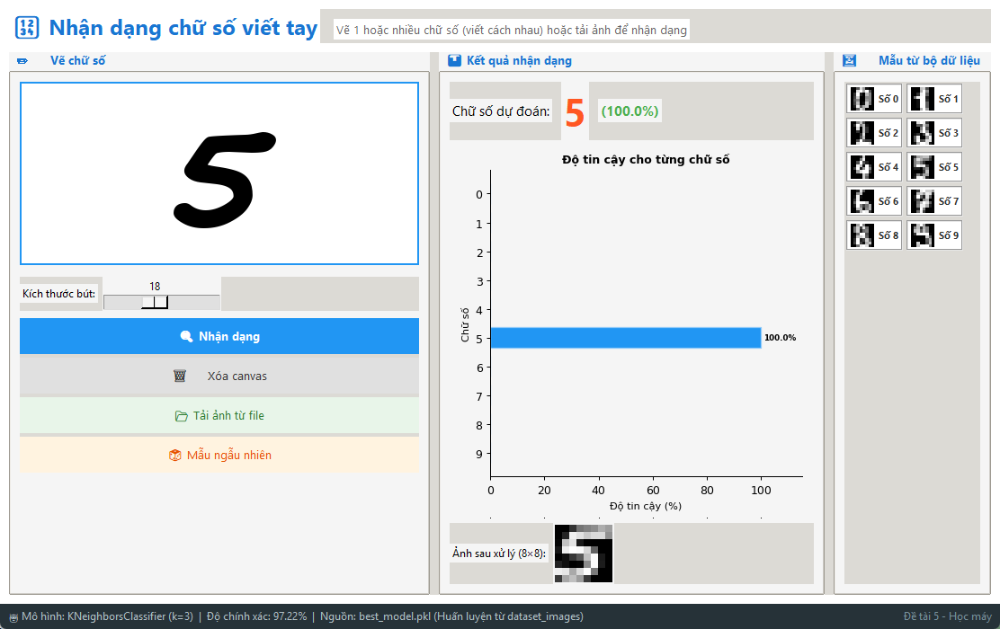
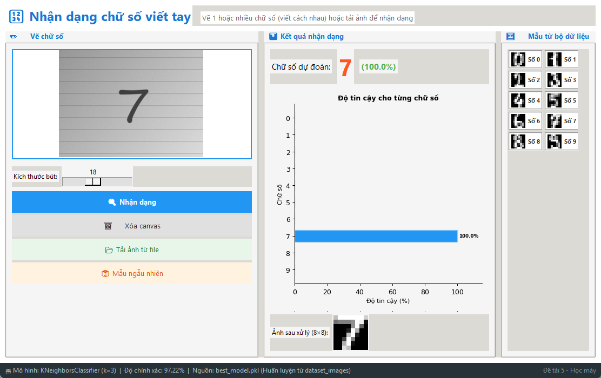

# Nhận dạng chữ số viết tay (Handwritten Digit Recognition)

**Học phần:** Nhập môn Học máy (FIT4013) – **Đề tài 5** (nhóm Thị giác máy tính)
**Trường Đại học Đại Nam – Khoa Công nghệ Thông tin – Lớp CNTT 18-10 – Nhóm 4**
**Giảng viên hướng dẫn:** ThS. Lê Thị Thùy Trang

| STT | Họ và tên | MSSV |
|:-:|---|:-:|
| 1 | Dương Đức Minh | 1871020396 |
| 2 | Nguyễn Tiến Thuận | 1871020562 |
| 3 | Ngô Minh Khôi | 1871020335 |
| 4 | Nguyễn Nhật Minh | 1871020395 |

---

## 1. Bài toán

Phân loại đa lớp có giám sát: đầu vào là ảnh xám 8×8 chứa một chữ số viết tay, đầu ra là nhãn 0–9.
Ứng dụng: đọc mã bưu chính, số hóa chứng từ/séc, chấm phiếu trắc nghiệm, nhập liệu biểu mẫu.

## 2. Dữ liệu

- **Nguồn (đúng bộ dữ liệu đề tài chỉ định):** [`sklearn.datasets.load_digits`](https://scikit-learn.org/stable/modules/generated/sklearn.datasets.load_digits.html) – bản test của bộ *Optical Recognition of Handwritten Digits*, UCI ML Repository, giấy phép CC BY 4.0.
- **Tổ chức:** `python main.py` xuất 1.797 ảnh PNG ra `dataset_images/<nhãn>/` (10 lớp). Pipeline đọc trực tiếp từ thư mục ảnh.
- **EDA:** 0 giá trị thiếu, 0 ảnh trùng lặp; lớp cân bằng (174–183 ảnh/lớp, 9,68%–10,18%).

## 3. Pipeline

```
dataset_images/ → grayscale, chia 255 → split 80/20 (stratify, random_state=42)
  → đặc trưng: Raw Pixels (64) | HOG (128) | PCA (28, fit trên Train, giữ 95,03% phương sai)
  → K-NN (k ∈ {1,3,5,7,9,11,15} × euclidean/manhattan) | Cây quyết định (max_depth ∈ {3,5,8,10,15,None} × gini/entropy)
  → chọn tham số bằng 5-Fold Stratified CV CHỈ trên Train → đánh giá 1 lần trên Test
  → phân tích lỗi → lưu best_model.pkl → GUI demo
```

Chống rò rỉ dữ liệu: PCA chỉ fit trên Train; siêu tham số chọn theo CV accuracy trên Train; tập Test chỉ dùng để báo cáo.

## 4. Kết quả chính (Test 360 ảnh)

Bảng đầy đủ 31 cấu hình: [model_comparison_results.csv](model_comparison_results.csv).

| Mô hình | Đặc trưng | Tham số | CV Acc (5-fold) | Test Acc | F1-macro |
|---|---|---|:-:|:-:|:-:|
| Baseline K-NN | Raw (64) | k=1, euclidean | 0.9840 ± 0.0028 | 97.78% | 97.76% |
| **Best K-NN (theo CV)** | **Raw (64)** | **k=3, euclidean** | **0.9903 ± 0.0034** | **97.22%** | **97.20%** |
| K-NN | PCA (28) | k=3, euclidean | 0.9889 ± 0.0041 | 97.50% | 97.48% |
| K-NN | HOG (128) | k=3, euclidean | 0.9255 ± 0.0064 | 91.94% | 91.88% |
| **Best Decision Tree (theo CV)** | **Raw (64)** | **depth=10, gini** | **0.8504 ± 0.0177** | **83.89%** | **83.82%** |
| Decision Tree | PCA (28) | depth=10, gini | 0.8247 ± 0.0237 | 85.83% | 85.84% |
| Decision Tree | HOG (128) | depth=10, gini | 0.7154 ± 0.0398 | 77.78% | 77.73% |

- K-NN vượt trội Cây quyết định (97,2% so với 83,9%). Cây quyết định quá khớp: Train 100%, CV ≈ 85%.
- PCA giảm 56% số chiều mà độ chính xác tương đương Raw: chênh lệch nằm trong độ lệch chuẩn CV, Test và CV cho kết luận ngược nhau. HOG không phù hợp với ảnh 8×8 (cell 2×2 chỉ có 4 pixel).
- Best K-NN sai 10/360 mẫu (2,78%). **5/10 lỗi là số 8 viết hẹp bị nhầm thành số 1.**
- Baseline k=1 cao hơn k=3 trên Test (chênh 2 mẫu), nhưng thấp hơn trên CV. Nhóm giữ nguyên tắc chọn theo CV.

Hình kết quả nằm trong `figures/`: EDA, phương sai PCA, tinh chỉnh k, overfitting của cây, ma trận nhầm lẫn, ROC, các mẫu sai.

## 5. Ứng dụng demo (GUI)

```bash
python gui_demo.py
```

- Vẽ **một hoặc nhiều chữ số** bằng chuột (các số viết cách nhau), ví dụ "2026". Ứng dụng tự tách từng chữ số.
- **Tải ảnh** từ file, kể cả ảnh chụp chữ viết trên giấy (nền xám, ánh sáng không đều, giấy kẻ dòng). Ảnh chụp điện thoại được tự xoay đúng chiều theo thông tin EXIF.
- Hiển thị xác suất 10 lớp và ảnh 8×8 sau xử lý (thứ mô hình thực sự "nhìn thấy").
- Có nút xem mẫu ngẫu nhiên từ tập Test, so sánh nhãn thật và nhãn dự đoán.

| Vẽ chữ số trên vùng vẽ | Tải ảnh chụp giấy kẻ dòng |
|:-:|:-:|
|  |  |

Ảnh mẫu để thử chức năng tải ảnh: [report/figures/demo_anh_giay_input.jpg](report/figures/demo_anh_giay_input.jpg).

Tiền xử lý ảnh ngoài bộ dữ liệu tái hiện đúng cách tạo bộ optdigits:
1. Trừ nền và lấy ngưỡng Otsu.
2. Xóa dòng kẻ giấy và đốm nhiễu.
3. Tách các chữ số theo khoảng trống giữa chúng; chữ số viết dính được cắt tại khe ít mực nhất.
4. Phóng chữ cho chiếm hết chiều cao khung 32×32.
5. Gộp khối 4×4 thành ảnh 8×8.

Kiểm thử trên ảnh mô phỏng bằng `python evaluate_gui_preprocessing.py` (kết quả ghi ra `report/gui_eval.tex`).

> **Giới hạn:** mô hình chỉ học từ 1.437 ảnh 8×8 của 43 người viết, nên trên ảnh thực tế độ chính xác thấp hơn nhiều so với tập Test. Cách viết cho kết quả tốt nhất: chữ số rõ, viết cách nhau, nét đậm vừa phải.

## 6. Cài đặt và chạy lại toàn bộ

```bash
pip install -r requirements.txt
```

```bash
python main.py
```

```bash
python generate_full_project.py
```

```bash
python create_notebook.py
```

```bash
python run_and_embed_notebook_outputs.py
```

```bash
python evaluate_gui_preprocessing.py
```

Thứ tự các lệnh trên:
1. `main.py` xuất ảnh ra `dataset_images/` (đã có sẵn, chỉ cần chạy lại khi muốn tạo mới).
2. `generate_full_project.py` chạy pipeline đầy đủ: hình, CSV, `best_model.pkl`, bảng LaTeX cho báo cáo.
3. `create_notebook.py` và `run_and_embed_notebook_outputs.py` sinh notebook rồi chạy bằng Jupyter kernel thật.
4. `evaluate_gui_preprocessing.py` kiểm thử GUI trên ảnh vẽ/ảnh chụp mô phỏng.

## 7. Báo cáo

Báo cáo [report/report.pdf](report/report.pdf) được viết bằng LaTeX ([report/report.tex](report/report.tex)) gồm đủ 6 phần bắt buộc theo hướng dẫn, đúng thứ tự:
1. Đặt vấn đề
2. Thiết kế giải pháp
3. Mã nguồn
4. Thử nghiệm
5. Thảo luận
6. Tổng kết

Phụ lục gồm phân công và khai báo AI.

Biên dịch bằng **XeLaTeX** (Overleaf: Menu → Compiler → XeLaTeX) hoặc Tectonic:

```bash
cd report && tectonic report.tex
```

## 8. Cấu trúc thư mục

```
├── main.py                           # Xuất dữ liệu load_digits → dataset_images/
├── generate_full_project.py          # Pipeline đầy đủ + hình + CSV + bảng LaTeX
├── create_notebook.py                # Sinh notebook
├── run_and_embed_notebook_outputs.py # Chạy notebook bằng Jupyter kernel (nbclient)
├── handwritten_digit_recognition.ipynb
├── gui_demo.py                       # Ứng dụng Tkinter
├── evaluate_gui_preprocessing.py     # Kiểm thử tiền xử lý GUI
├── best_model.pkl                    # K-NN (k=3, euclidean) đã huấn luyện
├── model_comparison_results.csv
├── digits_dataset.csv                # Bản CSV của dữ liệu (64 pixel + nhãn)
├── dataset_images/                   # 1.797 ảnh PNG, 10 thư mục lớp
├── figures/
├── report/                           # report.tex, report.pdf, bảng .tex tự sinh, figures/
├── requirements.txt
└── AI_USAGE.md
```

## 9. Khai báo sử dụng AI

Xem [AI_USAGE.md](AI_USAGE.md) và Phụ lục B của báo cáo.

## 10. Tài liệu tham khảo

1. E. Alpaydin, C. Kaynak. *Optical Recognition of Handwritten Digits*. UCI ML Repository, 1998.
2. F. Pedregosa et al. Scikit-learn: Machine Learning in Python. *JMLR* 12, 2011.
3. N. Dalal, B. Triggs. Histograms of Oriented Gradients for Human Detection. *CVPR*, 2005.
4. N. Otsu. A Threshold Selection Method from Gray-Level Histograms. *IEEE Trans. SMC*, 1979.
